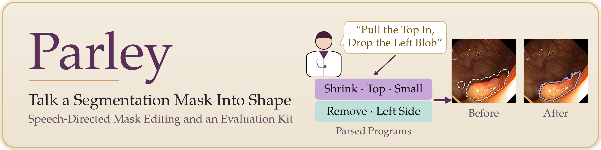
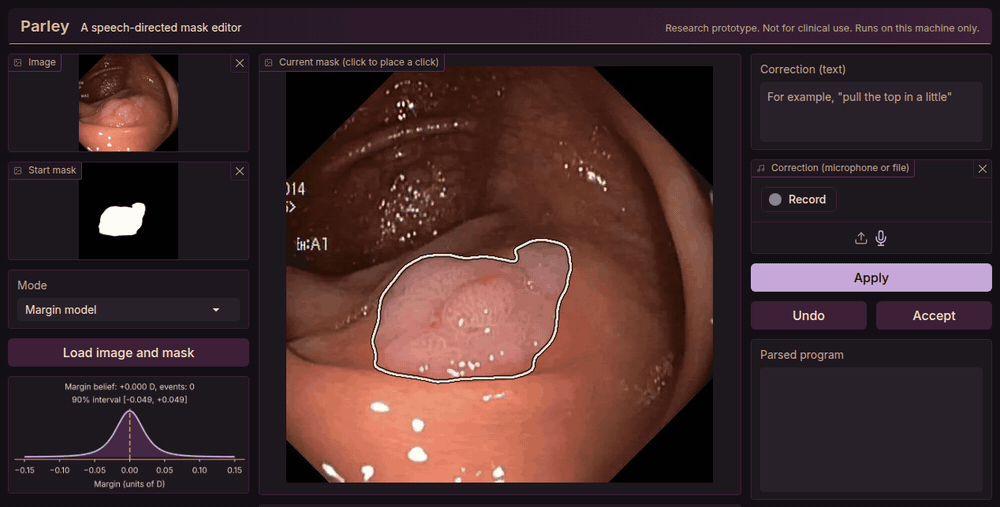
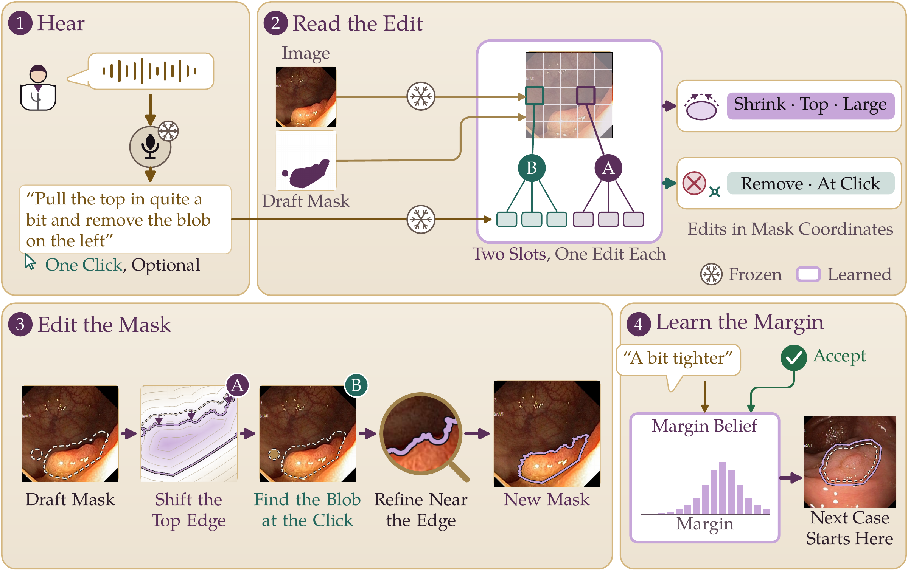
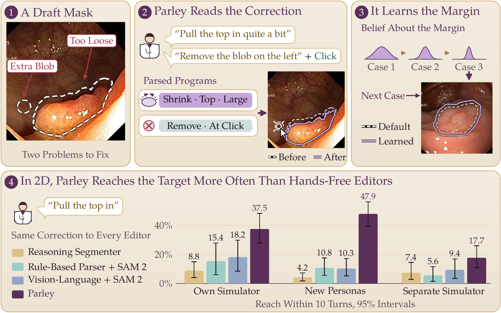

<p align="center">
  <picture>
    <source media="(prefers-color-scheme: dark)" srcset="assets/banner_dark.png">
    
  </picture>
</p>

<p align="center">
  <a href="https://thanh-huy-nguyen.github.io/parley/"></a>
  <a href="#citation"></a>
  <a href="#installation"></a>
  <a href="LICENSE"></a>
  <a href="WEIGHTS_LICENSE.md"></a>
  <a href="https://github.com/thanh-huy-nguyen/parley/actions/workflows/tests.yml"></a>
  <a href="#run-the-demo"></a>
</p>

<p align="center">
  <b>Parley: A Speech-Directed Segmentation Editor and Its Evaluation Across Separately Authored Simulators</b><br>
  Thanh-Huy Nguyen, Ulas Bagci<br>
  Department of Radiology, Northwestern University<br>
  <a href="https://thanh-huy-nguyen.github.io/parley/">Project page</a>
</p>

Parley edits a 2D segmentation mask from a spoken or typed correction. You give it an image, the current mask and a
sentence such as *"pull the top in a little"*, with an optional click. Parley reads the sentence into a short edit
program written in the coordinates of the mask, runs the program, and returns the new mask together with the program it
understood, so every turn can be checked and undone.

The package also contains `parley.evalkit`, a small kit for testing any conversational editor against simulated
clinicians, with the outcomes and clustered intervals used in the paper.

<p align="center">
  
  <br><sub>The local demo on a validation image: three corrections, each with the program Parley parsed, then undo. Real model output, seed 0, CPU.</sub>
</p>

## Contents

- [Overview](#overview)
- [Installation](#installation)
- [Quick start](#quick-start)
- [Run the demo](#run-the-demo)
- [Model weights](#model-weights)
- [Evaluation kit](#evaluation-kit)
- [Results](#results)
- [Limitations](#limitations)
- [Citation](#citation)
- [License](#license)

## Overview

<p align="center">
  
  <br><sub>One turn of Parley. Frozen encoders carry a snowflake; learned parts are lilac. Masks are illustrations.</sub>
</p>

**Edits in the coordinates of the mask.** "The top" is the arc of the boundary whose outward normal points up, "a
little" is a fraction of the lesion's equivalent diameter, and "pull in" is a signed change of the signed distance
function on that arc. A network with two query slots reads up to two such programs from one utterance, and the
executor applies them. The program is shown to the user, so a wrong reading is visible before it is accepted.

**A margin model per clinician.** Clinicians disagree about where a boundary lies. Because each correction has a sign
and a size in lesion units, Parley can keep a Bayesian posterior over a clinician's preferred margin, updated exactly on
a grid after every turn, with no gradient step. Low-rank adapters are available as an alternative.

**An evaluation kit.** `parley.evalkit` runs any editor through any simulated clinician behind two small interfaces and
reports reach, gain, the shares of masks improved and made worse, simulated time, and a two-way bootstrap over
clinicians and images. The paper uses it to measure how much of an editor's gain carries over to a simulator written
separately from the editor.

## Installation

Parley needs Python 3.11 and runs on a CPU or a CUDA GPU. The steps below take about five minutes.

- [ ] **1. Create an environment.** Python 3.11, plus ffmpeg on the path if you use audio files.
- [ ] **2. Install the package.**
- [ ] **3. Download the weights** (32 MB per seed).
- [ ] **4. Check the weights.**
- [ ] **5. Run a first edit.**

```bash
# 1. environment
conda create -n parley python=3.11 -y && conda activate parley
conda install -c conda-forge ffmpeg -y                # only needed for audio files

# 2. package (add [demo] for the web demo, [test] for pytest)
git clone https://github.com/thanh-huy-nguyen/parley.git && cd parley
pip install -e ".[demo]"

# 3. weights, into the default location
mkdir -p ~/.cache/parley/weights
for s in 0 1 2; do
  curl -L -o ~/.cache/parley/weights/parley-editor-s$s.pt \
    https://github.com/thanh-huy-nguyen/parley/releases/download/v0.1.0/parley-editor-s$s.pt
done

# 4. check: prints the file that will be used and verifies its SHA-256
parley weights --seed 0

# 5. a first edit on your own image and mask
parley edit --device cpu --image image.png --mask mask.png --text "pull the top in a little" --out new.png
```

All dependencies are pinned in `pyproject.toml`, and `requirements-lock.txt` lists the full environment the tests ran
in. The frozen models (SAM 2.1 tiny, all-MiniLM-L6-v2 and whisper-small.en) download from Hugging Face on first use, at
the commits recorded in `src/parley/weights_manifest.json`. Set `HF_HUB_OFFLINE=1` afterwards to work from the cache.

A CPU-only install is smaller. Install the CPU wheels of the pinned torch version first:

```bash
pip install --index-url https://download.pytorch.org/whl/cpu torch==2.14.1 torchaudio==2.11.0 torchvision==0.29.1
pip install -e ".[demo]"
```

## Quick start

**Python**

```python
from parley import ParleyEditor

editor = ParleyEditor(mode="listener", seed=0, device="cpu")   # or device="cuda"
editor.begin_session(clinician_id="reader_1", dataset="colonoscopy")
mask = editor.begin_image("image.png", "mask.png")             # paths or arrays

result = editor.edit(text="pull the top in a little")          # or wav="turn.wav"; click=(x, y) is optional
print(result.status, result.programs)                          # what was understood
editor.undo()                                                  # step back one turn

result = editor.edit(text="get rid of the blob on the left", click=(120, 88))
editor.end_image(accepted=True)                                # the next image starts at the learned margin
print(editor.belief()["mean"])                                 # the clinician's margin, in units of D
```

**Command line**

```bash
parley edit --image x.png --mask m.png --text "pull the top in a little" --out new.png
parley edit --image x.png --mask m.png --wav turn.wav --click 120 88 --out new.png --json
```

The command prints the transcript, the status and the parsed program. Exit codes are 0 for success, 2 for bad input and
3 for a weights problem.

**Modes.** `base` reads and executes. `listener` adds the margin model, whose mean offsets each new start mask once.
`adapter` adds rank-4 corrections of the decoders, fitted at the end of each accepted image. `listener+adapter` has
both. Session state saves to a pickle-free `.npz` with `save_state` and `load_state`.

See [docs/usage.md](docs/usage.md) for the input contract, what the edit language can and cannot express, behavior on
unusual inputs and session state.

## Run the demo

```bash
parley demo --device cpu          # then open http://127.0.0.1:7860
```

The demo takes an image and a mask, a correction by microphone, audio file or text, and an optional click on the
image. It shows the parsed program and the margin belief, and offers undo and accept. It binds to `127.0.0.1` and never
creates a public share link, so audio and images stay on your machine.

**Docker**

```bash
docker build --build-arg TORCH_INDEX=https://download.pytorch.org/whl/cpu -t parley:cpu .
docker run --rm -p 127.0.0.1:7860:7860 -e PARLEY_DEMO_HOST=0.0.0.0 \
  -v ~/.cache/parley/weights:/weights parley:cpu parley demo --device cpu
```

## Model weights

Three checkpoints were trained with seeds 0, 1 and 2; the paper averages over them. Each holds about 7.6 million
trained parameters on top of the frozen encoders, and each is checked against its SHA-256 before it loads.

| Seed | File | SHA-256 (first 16) | Size |
|:---:|---|---|---:|
| 0 | `parley-editor-s0.pt` | `c5cf3e70f34faeb6` | 32 MB |
| 1 | `parley-editor-s1.pt` | `72d3b2dee645e1df` | 32 MB |
| 2 | `parley-editor-s2.pt` | `fa736d610457da71` | 32 MB |

Parley looks for weights in this order: the `weights=` argument or `--weights`, the `PARLEY_WEIGHTS` environment
variable, then `~/.cache/parley/weights/`. Weights you trained yourself load with `verify=False` or `--no-verify`.

The weights were trained on BUSI (breast ultrasound) and Kvasir-SEG (colonoscopy), training splits only, with
synthetic speech: no recorded clinical speech was used. [MODEL_CARD.md](MODEL_CARD.md) describes the training data and
the known failures.

## Evaluation kit

An editor under test implements four methods (`begin_session`, `begin_image`, `step`, `end_image`), and a simulated
clinician implements four (`target`, `accept`, `next_utterance`, `click`). The kit runs the dialogues and computes the
outcomes.

```python
from parley import ParleyEditor
from parley.evalkit import Case, ParleyEvalAdapter, run_study, summarize, summary_markdown

records = run_study(ParleyEvalAdapter(ParleyEditor(device="cpu")), my_clinicians,
                    {"my_data": [Case("id1", "my_data", rgb, start_mask, reference_mask)]})
print(summary_markdown({"parley": summarize(records)}))
```

`examples/evalkit_toy_run.py` runs a toy clinician end to end on synthetic cases or on your own folders. The toy
clinician only shows the interface; its numbers are not an evaluation. [docs/evalkit.md](docs/evalkit.md) defines every
outcome and lists what the kit leaves to you.

`scripts/benchmark.py` times the stages of a turn (image encoding, recognition, the turn from a transcript, and audio to
mask) on your machine, with your images or synthetic ones.

## Results

<p align="center">
  
  <br><sub>Panels 1 to 3 are illustrations made from the ground truth. Panel 4 shows reach with 95% intervals.</sub>
</p>

One frozen editor was tested with three groups of simulated clinicians on breast ultrasound and colonoscopy: the
simulator it was built with, personas written separately in the same language, and a simulator written separately with
its own language, voices and test images. Reach is the share of dialogues needing correction that get within IoU 0.85
of the clinician's target in 10 turns. The strongest hands-free editor is a fine-tuned vision-language model that
prompts SAM 2, or a rule-based parser feeding SAM 2, whichever reaches more.

| Simulated clinicians | Parley reach | Strongest hands-free editor | Parley mean gain in IoU |
|---|:---:|:---:|:---:|
| Own simulator (validation images) | **37.5%** | 18.2% | +0.140 |
| Separately written personas | **47.9%** | 10.8% | +0.154 |
| Separately authored simulator (test images) | **17.7%** | 9.4% | +0.026 |

The comparisons with hands-free editors are post hoc and exploratory. On the separately authored simulator, the 95%
interval of Parley's lead over the strongest editor includes zero. The paper gives every interval.

The gain measured on the simulator built with the editor did not carry over to the separately authored one: it fell
from +0.140 to +0.026, a drop that a click-based control did not show. This is the central finding of the paper, and
the evaluation kit exists so that other groups can run the same check on their own editors.

On 8 CPU threads, a spoken correction takes a median of 1.4 s from audio to mask, most of it in the speech recognizer;
given a transcript, a turn takes 147 ms. On a GPU, audio to mask takes 224 ms.

## Limitations

Parley is a research prototype. It is not a medical device and must not be used for diagnosis or treatment.

- All training speech was synthetic, and the evaluation in the paper used simulated clinicians. Two physicians have
  tried the demo with a live microphone, but Parley has not been evaluated in a clinical study.
- On the separately authored simulator, SAM 2 given the simulator's clicks reached the target more often than Parley,
  and a cached SAM 2 click is much faster than a spoken turn. Speech is meant for moments when the hands are busy.
- English only. Trained on two 2D modalities. Other images are accepted with no check that the model applies to them.
- The edit language has limits: no smoothing, no hole filling on request, no anatomy or appearance references, no
  absolute lengths, at most two edits per turn. A mask can get worse, which is why every turn shows its program and
  can be undone.

## Citation

```bibtex
@article{nguyen2026parley,
  title   = {Parley: A Speech-Directed Segmentation Editor and Its Evaluation Across Separately Authored Simulators},
  author  = {Nguyen, Thanh-Huy and Bagci, Ulas},
  journal = {Computer Methods and Programs in Biomedicine},
  year    = {2026},
  note    = {Under review}
}
```

## License

The code is released under the [Apache License 2.0](LICENSE). The trained weights are released for non-commercial
research use under [CC BY-NC 4.0](WEIGHTS_LICENSE.md), because one training dataset, Kvasir-SEG, forbids commercial use
without permission. No dataset is distributed here. [THIRD_PARTY.md](THIRD_PARTY.md) lists the terms of the frozen
models and the datasets.

## Acknowledgments

Parley builds on SAM 2.1, Whisper and all-MiniLM-L6-v2 as frozen encoders, and on BUSI and Kvasir-SEG for training.
Training language was phrased with Qwen2.5-7B-Instruct and spoken with Kokoro.
